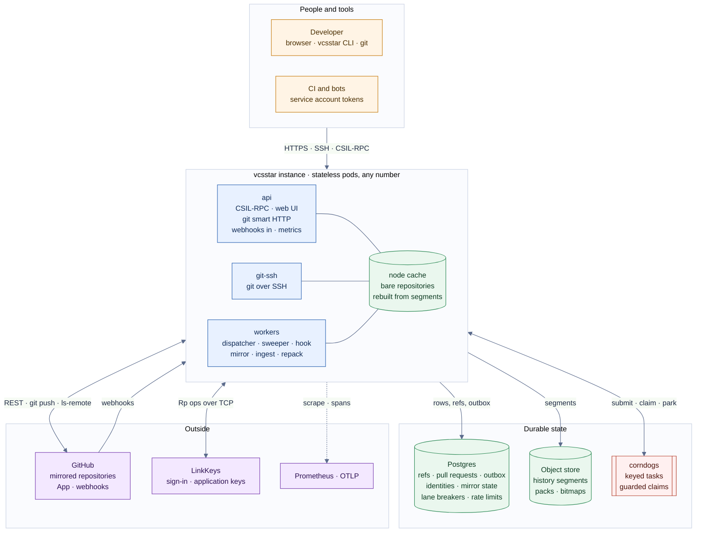
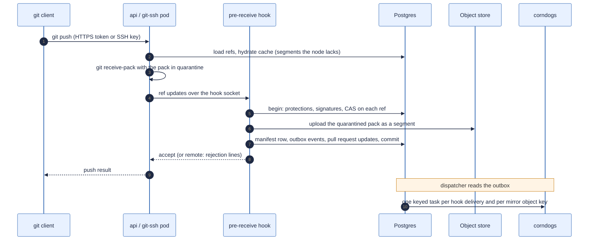
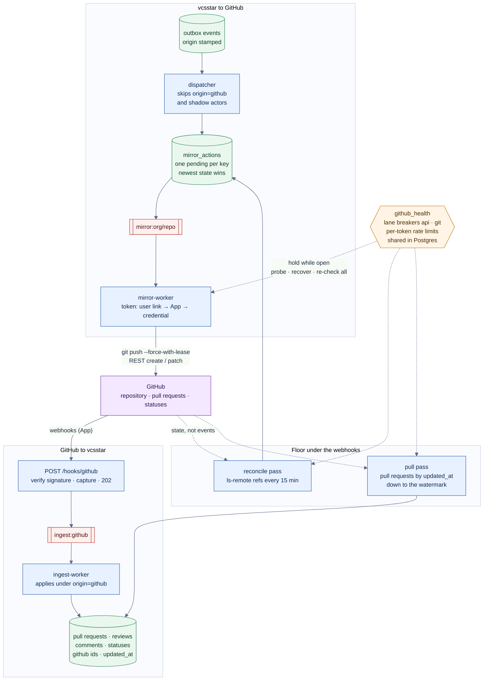
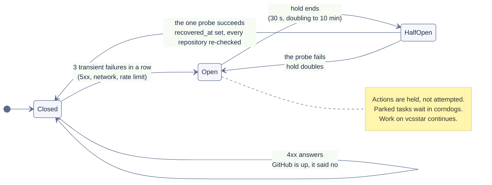
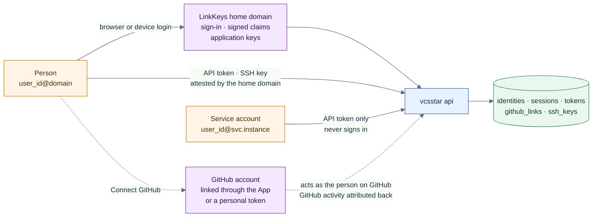

# vcsstar architecture

vcsstar is the place a team works on code: pushes, pull requests, reviews,
statuses, and the API around them. GitHub stays the published copy that the
rest of the world reads, and vcsstar keeps both sides in step in both
directions. When GitHub is down, work on vcsstar continues; when GitHub
comes back, the mirror catches up. This document shows the pieces and how
they fit. The repository guide (`CLAUDE.md`) holds the rules each piece
follows; the plans under `plan/` hold the reasoning.

## The pieces

The web UI is plain TypeScript on Zest web components; it speaks CSIL-RPC
to the api pods and nothing else. Every pod runs the roles its deployment names. The pods hold no state of
their own: sessions, tokens, refs, pull requests, the outbox, mirror state,
the GitHub lane breakers, the rate table, and the pass clocks live in
Postgres; pending work lives in corndogs; history lives in the object store.
A pod's repository cache is a disposable projection that it rebuilds in the
background after a restart. Any number of pods can therefore run every role.

## A push

A push is one transaction. The hook is the transaction point, Postgres holds
the refs with compare-and-swap, and the pack becomes an immutable history
segment before the push is acknowledged.

## Keeping GitHub in step

The dispatcher turns outbox events into at most one pending mirror action
per object key (a ref, a pull request, a comment, a status). Workers claim
tasks from corndogs, read the desired state from Postgres at that moment,
and converge GitHub to it. Inbound, every GitHub webhook is captured first
and processed later; a pull-based pass asks GitHub for what webhooks missed.

What makes this safe to repeat: every row remembers its GitHub id and
GitHub's `updated_at`, bodies vcsstar posts carry a marker, a snapshot older
than the applied one is ignored, and nothing written under origin `github`
or by a shadow actor is ever sent back.

## When GitHub is down

Work made on vcsstar during an outage is a bounded set of pending actions,
not a log: a day of pushes to one branch is one action carrying the newest
target. Work made on GitHub during an outage is found by the pull pass when
the lane recovers. Rate limits are respected per token: below a reserve the
token waits for its window, and a `Retry-After` is honoured.

## Identity

Identity keys are `user_id@domain` and never a handle. Standing consent at
the home domain is per application: vcsstar signs people in as the
application `vcsstar` of its LinkKeys account, the same application its
instance keys and act-as grants use. A linked GitHub
account makes vcsstar act on GitHub as that person; an unlinked actor's
work goes through the instance's GitHub App, then the organization's
credential. GitHub accounts without a link appear as shadow identities.

## Where to read more

| Topic | Where |
| --- | --- |
| Rules every piece follows, local development, roles, configuration | `CLAUDE.md` |
| The contract every client and the CLI are generated from | `csil/vcsstar.csil` |
| Chart and instance overlays | `helm/vcsstar`, `deploy/values-example.yaml` |
| Future thinking on CI scale (bundle-URI, memory cache workers) | `plan/15-future-ci-scale.md` (local plans, not in the repository) |
