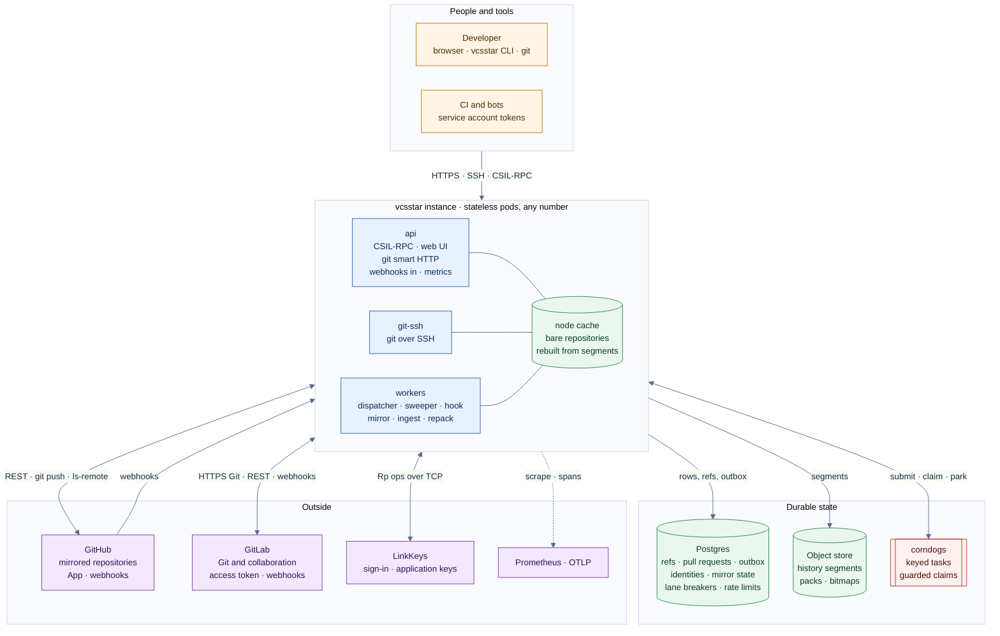
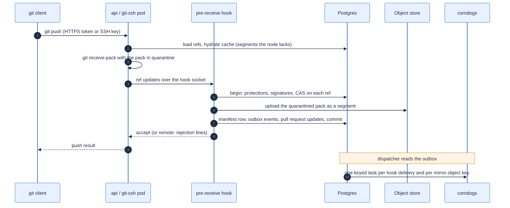
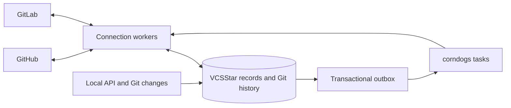
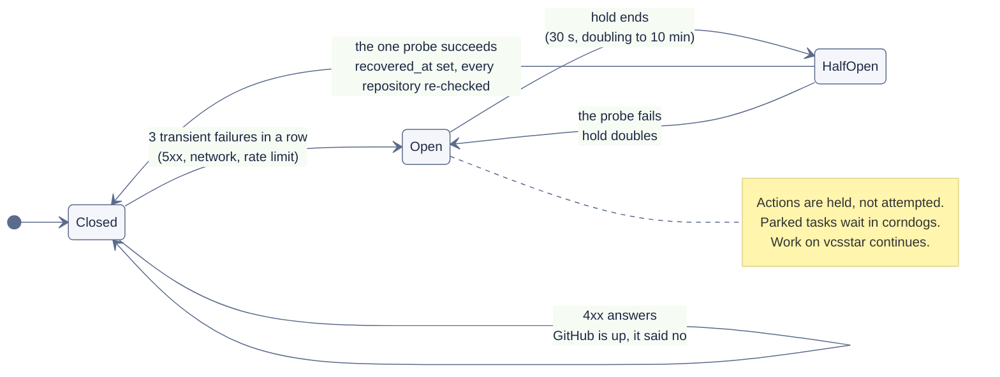
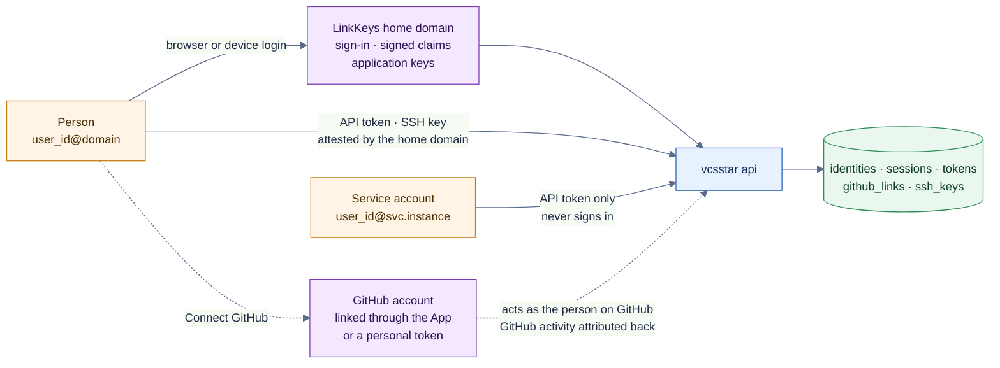

# vcsstar architecture

VCSStar stores code and collaboration records. One repository can connect
to multiple GitHub and GitLab repositories. Changes from any connected
system can reach every configured destination. Each system keeps control
of its authentication, authorization, visibility, and protection rules.
Other VCSStar instances are future destinations.

The [sync guide](gitlab.md) describes setup, conflicts, history, and API
limits. GitLab.com and self-hosted GitLab use REST API v4 and HTTPS Git.
The repository guide (`CLAUDE.md`) gives the implementation rules.

## The pieces

The web UI is plain TypeScript on Zest web components; it speaks CSIL-RPC
to the api pods and nothing else. Every pod runs the roles its deployment names. The pods hold no state of
their own: sessions, tokens, refs, pull requests, the outbox, mirror state,
the GitHub lane breakers, the rate table, and the pass clocks live in
Postgres; pending work lives in corndogs; history lives in the object store.
A pod's repository cache is a disposable projection that it rebuilds in the
background after a restart. Any number of pods can therefore run every role.

## A push

A push is one transaction. The hook is the transaction point, Postgres holds
the refs with compare-and-swap, and the pack becomes an immutable history
segment before the push is acknowledged.

## Connection sync

Each connection stores its provider, host, project, setup options, inbound
and outbound switches, and progress. New connections start with both
directions disabled. Admins can configure branch authority and override
accounts after deployment, then enable each direction. Disabling a
direction retains its accepted copies. The worker checks the current
switches before each item. An item already in progress can finish. Each object has a local record and a mapping at each destination.
The worker compares both sides with their own accepted copies. This permits
a full native record and a remote summary to differ without an echo loop.

A conflict uses a preferred source or waits for an assigned identity or
team. Only that item stops. The worker applies each native change with its
outbox event in one transaction. It retains original provider responses
and records of deleted items. Permission failures remain visible errors.

The `mirror-worker` role runs `sync:connections` tasks. A PostgreSQL advisory
lock permits one connection pass per repository. Polling retries failed
work. Incoming webhooks authenticate and enter corndogs before the HTTP
receiver acknowledges them. The worker stores the raw body and reads the
remote API. A failed page cannot appear as a set of deleted records.

Enabled legacy mirrors become connections after import. The old GitHub
executors no longer process those repositories. Legacy tables remain for
import status and old object IDs. The new policy replaces the old mirror
mode. The generated CSIL operations expose connection setup, policy,
resolution, account links, and stored records to both the UI and CLI.

## When GitHub is down

Work made on vcsstar during an outage is a bounded set of pending actions,
not a log: a day of pushes to one branch is one action carrying the newest
target. Work made on GitHub during an outage is found by the pull pass when
the lane recovers. Rate limits are respected per token: below a reserve the
token waits for its window, and a `Retry-After` is honoured. GitHub limits
the rate per App installation, so an instance may have several GitHub Apps:
each call goes through the installed App with the most calls left. The
rate state of every token is a Prometheus gauge with the App id as a label.

A new mirror also imports its history: every pull request GitHub has, from
the first one, with its reviews and comments, at GitHub's own numbers and
times. The import keeps its position after each pull request and keeps a
larger rate reserve than live work, so pushes and comments go through while
it runs.

Enabling a repository is durable work too. The request makes the
repository row and puts one import task into corndogs, then answers. A
mirror worker fetches the branches and tags and enables the mirror; a pod
restart only delays the task, and a failed attempt waits and tries again.
"Enable all" queues every repository of the GitHub owner at once. Each
repository has its own cadence for the pull-based passes (15 minutes by
default).

## Access

What a caller can do decides what is shown and what is requested. An
anonymous caller reads public repositories. Organization roles (owner,
admin, member) and repository roles (admin, maintain, write, read) come
back on the records the caller reads (`viewer_role`), and the web UI builds
only the sections that role can use. Instance roles sit above them: an
instance admin manages everything, an instance viewer reads every
repository. Admins set instance roles; a policy from LinkKeys claims is
planned.

## Branch authority

Each protected branch has one update authority: this instance or one
configured provider connection. The conflict resolver cannot bypass that
choice. The common ref gate checks authority, account overrides, and
branch policy before the database ref changes. PR merge checks run again
inside the final transaction. Git signatures are optional and are not
required by the default protections. See `gitlab.md` for the policy fields.

## Identity

Identity keys use `user_id@domain`. The home domain records consent for each
application. In LinkKeys 0.16.11, set the application ID on the account
that owns the RP API key to `vcsstar`. Login, instance keys, and act-as
grants use this ID. A linked GitHub
account makes vcsstar act on GitHub as that person; an unlinked actor's
work goes through one of the instance's GitHub Apps, then the
organization's credential. GitHub accounts without a link appear as shadow identities.

Local accounts are created by instance admins. They use salted Argon2id
password hashes and the same session and device-token flow as LinkKeys.
A local account can bind to a verified LinkKeys identity. That operation
preserves its internal identity ID, removes password access, and revokes
old credentials. A database trigger prevents local-login restoration.
Local identity coordinates are not proof of a LinkKeys identity.

VCSStar-to-VCSStar transport remains unimplemented. Its trust contract
must authenticate metadata about objects and events through LinkKeys.
It must not infer identity from Git author fields or require attested Git
commit signatures. GitHub and GitLab use their own provider credentials.

## LinkKeys trust-guard integration

VCSStar stores review head and base SHAs, an optional approval scope, and
review invalidation state. These fields do not complete the Reactorcide
approval integration. That integration remains unimplemented.

The Reactorcide provider adapter must convert an approved VCSStar review
into a coordinator approval. It must verify the reviewer's LinkKeys
identity and resolve membership in the provider-neutral group
`reactorcide_group:linkkeys-trust-maintainers`. The approval must name the
PR, current head SHA, current base SHA, and content scope
`linkkeys-trust-anchors`. A content approval must remain separate from
permission to run CI. A head or base change must invalidate the approval.
Reactorcide must evaluate the trust guard again after approval.

The original request for mandatory attested Git commit signatures was
superseded by the agreed branch authority and metadata trust rules.
Required checks must use configured trusted reporter accounts. Each
protected branch has one update authority. A conflict decision must not
permit an update from another source.

### Next Actions

Agree on the Reactorcide provider and approval contract. Implement the
adapter, group resolution, content approval handling, and evaluation after
approval. Verify that a maintainer's scoped approval reaches the LinkKeys
trust guard with the current head and base SHAs. Verify that stale or
unauthorized approvals are refused before using VCSStar as the job source.
Implement and verify LinkKeys-authenticated metadata before enabling
VCSStar-to-VCSStar exchange.

## Where to read more

| Topic | Where |
| --- | --- |
| Rules every piece follows, local development, roles, configuration | `CLAUDE.md` |
| The contract every client and the CLI are generated from | `csil/vcsstar.csil` |
| Chart and instance overlays | `helm/vcsstar`, `deploy/values-example.yaml` |
| Future thinking on CI scale (bundle-URI, memory cache workers) | `plan/15-future-ci-scale.md` (local plans, not in the repository) |
